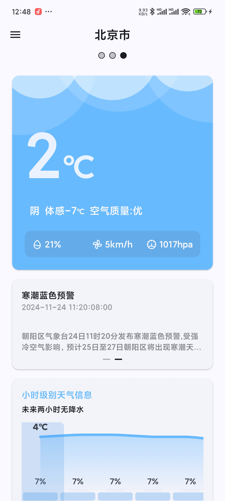

# 柠檬天气的Flutter 版本

## 开发环境与构建

基座已迁移到 Flutter 3.47，验证使用 Flutter 3.47.7 stable / Dart 3.13.5。

- Flutter >= 3.47.0，Dart >= 3.13.0 < 4.0.0。
- Android：Gradle 9.3.1、Android Gradle Plugin 9.1.0，启用内置 Kotlin，编译目标为 Java 17；支持使用 Android Studio 自带的 Java 25 运行 Gradle。
- Android 最低 API 24，compileSdk / targetSdk / NDK 版本跟随 Flutter SDK；当前应用仅打包 arm64-v8a。
- iOS 最低版本 15.0，需要 macOS 和 Xcode。已保留 UIScene 生命周期，并配置定位权限、后台刷新和 CocoaPods 静态链接回退。

```sh
flutter pub get
dart run build_runner build
flutter analyze --no-fatal-infos
flutter test
flutter build apk --debug
flutter build apk --release --target-platform android-arm64
```

`flutter analyze` 剩余提示为原有天气枚举和 GetX 路由常量的大写命名，使用 `--no-fatal-infos` 可检查错误和警告。修改数据库定义后需重新运行 `build_runner` 并提交生成文件。

SQLite 通过 `sqlite3` 3.x 的原生资源机制打包，已移除停止维护的 `sqlite3_flutter_libs` 及未使用的 `drift_flutter`。数据库仍使用应用文档目录下的 `db.sqlite`，schemaVersion 保持为 2。

在 macOS 上执行 `flutter build ios --no-codesign` 验证 iOS 构建。Flutter 会在首次构建时配置 Swift Package Manager；需要 CocoaPods 回退时，使用仓库中的 `ios/Podfile`。

迁移参考：[Flutter 内置 Kotlin 迁移指南](https://docs.flutter.dev/release/breaking-changes/migrate-to-built-in-kotlin/for-app-developers)、[SQLite 3.x 升级说明](https://pub.dev/packages/sqlite3_flutter_libs)。

## 预览图

<div style="display: flex;justify-content: flex-start">



</div>

## 暗色模式

<div style="display: flex;justify-content: flex-start">


</div>

## 技术栈及其使用的开源库

- Drift 持久化库
- Dio 网络请求库
- GetX 状态管理库
- 自实现的天气转场动画

## 正在做的

~~1.天气动画优化~~
~~2.城市选择支持排序/删除~~
~~3.天气预警~~
~~4.天气详情页~~
~~5.城市选择页面优化~~
~~6.定位功能~~
7.天气预警详情页
